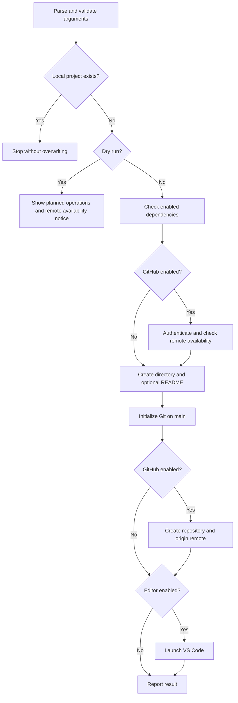
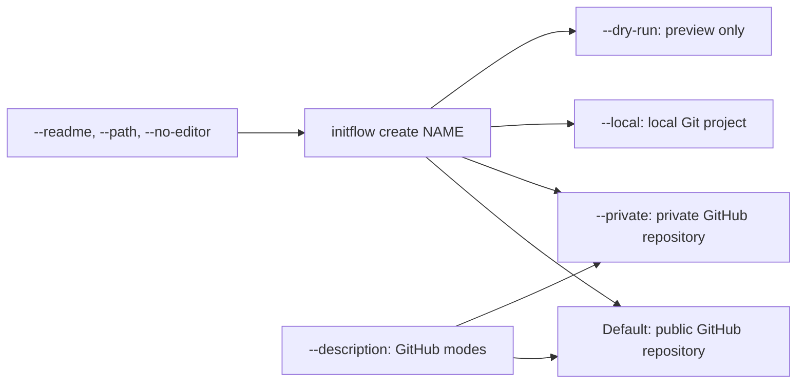

# Init Flow

[](https://github.com/jacivaldocarvalho/init-flow/actions/workflows/ci.yml)
[](https://www.gnu.org/software/bash/)
[](https://git-scm.com/)
[](https://cli.github.com/)
[](LICENSE)

[](https://github.com/jacivaldocarvalho/init-flow/releases)


**Automate local project creation and GitHub repository setup directly from your terminal.**

**Init Flow** is an open-source Command-Line Interface (CLI) built with Bash to simplify and standardize the initialization of software development projects.

The goal is to eliminate repetitive setup tasks, allowing developers to start new projects with a single command.

**Project Status:** v0.2.0 prepared; v0.1.0 is the latest published release.

## Contents

- [Quick Start](#quick-start)
- [Create options](#create-options)
- [Examples](#examples)
- [Terminal demos](#terminal-demos)
- [How it works](#how-it-works)
- [Installation](#installation)
- [Documentation](#documentation)
- [Security and Safe Usage](#security-and-safe-usage)
- [Contributing](#contributing)

## Quick Start

Install from the cloned repository with `./scripts/install.sh` (see the [Installation Guide](docs/installation.md)). For a local Git project that needs no GitHub access or editor:

```bash
initflow create my-project --local --readme --no-editor
```

This creates `~/projects/my-project`, initializes Git on `main`, and writes `README.md`. It does not commit or push files.

## Overview

Init Flow aims to automate the project initialization process, from creating a local directory to configuring a remote Git repository.

The default command is:

```bash
initflow create my-project
```

This command will:

1. Create a project directory under `~/projects/`.
2. Initialize Git with `main` as the default branch.
3. Create a public GitHub repository.
4. Configure the `origin` remote.
5. Open the project in Visual Studio Code.

## Create options

| Option | Effect |
|---|---|
| `--private` | Create a private GitHub repository; public is the default |
| `--readme` | Generate a local `README.md` |
| `--description TEXT` | Set the GitHub repository description |
| `--local` | Create a local Git project without GitHub integration |
| `--path DIRECTORY` | Override the projects base directory |
| `--no-editor` | Skip Visual Studio Code launch |
| `--dry-run` | Preview operations without creating resources |

`--local` cannot be combined with `--private` or `--description`. Paths can be absolute or relative to the original working directory, including paths with spaces. Base directory precedence: `--path` > `INITFLOW_PROJECTS_DIR` > `$HOME/projects`.

## Examples

```bash
# Default: public GitHub repository and VS Code
initflow create my-project

# Private GitHub repository
initflow create private-api --private

# Local Git project with README
initflow create local-tool --local --readme --no-editor

# Description and custom base directory
initflow create team-tool --description "Tools & automation" --path "$HOME/work projects" --readme --no-editor

# Preview a private repository without GitHub access or filesystem changes
initflow create preview-api --dry-run --private --description "Preview & plan" --readme --path "work projects" --no-editor
```

## Terminal demos

Both recordings run the current source executable in isolated temporary directories. Their [quick-start tape](assets/demo/quick-start.tape) and [customization tape](assets/demo/customization.tape) can be regenerated with VHS from the repository root.

**Local quick start** — Git initialization and optional README, with no GitHub or editor launch:


**Customization preview** — private visibility, README, description, custom path, and no editor launch. This dry-run makes no filesystem or remote changes:


## How it works





GitHub creation failures preserve the local project. Dry-run needs no Git, GitHub CLI, authentication, or VS Code and does not verify remote availability. The automated suite currently passes **58 tests** across CLI, creation, installation, and uninstallation checks.

## Tech Stack

| Technology | Purpose |
|---|---|
| Bash | CLI development |
| Git | Source code version control |
| GitHub CLI | GitHub repository management |
| Visual Studio Code | Development environment |
| ShellCheck | Static analysis for shell scripts |
| GitHub Actions | Continuous integration |

## Requirements

- Linux (Ubuntu/Debian)
- Bash
- Git
- GitHub CLI (`gh`) with an authenticated account for remote projects
- Visual Studio Code with the `code` command available when editor launch is enabled

## Installation

Init Flow can be installed locally from the source repository using the provided installation script.

Running `./scripts/install.sh` creates `~/.local/bin/initflow` as a symbolic link to `scripts/initflow` in that clone. Once a new release is available in the same clone, `git pull` updates the CLI without reinstalling it. The installer does not overwrite a link to another clone or an existing file.

For detailed setup instructions, requirements, and troubleshooting, see the [Installation Guide](docs/installation.md).


### Uninstallation

To uninstall Init Flow from your local environment, navigate to the cloned repository and run:

```bash
./scripts/uninstall.sh
```

The uninstaller safely removes the installation symbolic link without deleting user projects, GitHub repositories, or source files.

For more information, see the [Installation Guide](docs/installation.md).


## Documentation

- [Installation](docs/installation.md)
- [Usage](docs/usage.md)
- [Architecture](docs/architecture.md)
- [Troubleshooting](docs/troubleshooting.md)
- [Roadmap](docs/roadmap.md)
- [Security and Safe Usage](docs/security.md)

## Contributing

Contributions, bug reports, and feature suggestions are welcome.

Please read [CONTRIBUTING.md](CONTRIBUTING.md) before submitting a contribution.


## Security and Safe Usage

Init Flow is designed to minimize unintended changes to local files and GitHub repositories.

Key safeguards include:

- Project name validation.
- Protection against overwriting existing project directories.
- GitHub authentication through the official GitHub CLI.
- No direct storage of GitHub credentials or access tokens.
- Safe installation without `sudo` or overwriting existing files.
- Isolated automated tests using temporary directories.
- Preservation of local project files when remote operations fail.

**Important:** GitHub repositories are public by default. Use `--private` when needed.

Init Flow is under active development, and not all failure scenarios are covered by automated tests.

For detailed security considerations, known limitations, and recommended practices, see the [Security and Safe Usage Guide](docs/security.md).


## Author

**Jacivaldo Carvalho**

Telecommunications Engineer | DevOps Engineer | SRE | Networking

[GitHub](https://github.com/jacivaldocarvalho) | [LinkedIn](https://www.linkedin.com/in/jacivaldocarvalho) | [Website](https://www.jacivaldocarvalho.com/)

## License

This project is licensed under the MIT License. See [LICENSE](LICENSE) for details.
